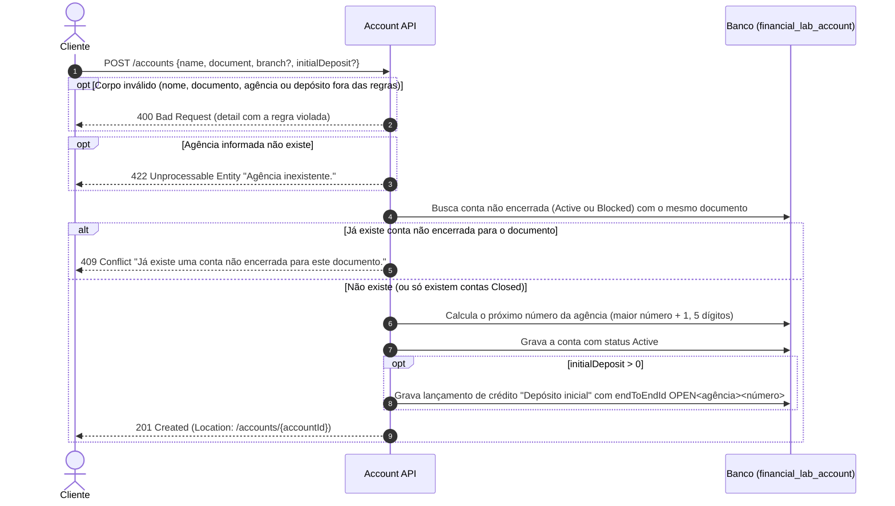

# Abrir Conta

## Versionamento

| Versão | Data | Descrição |
|---|---|---|
| 1.0.0 | 2026-11-13 | Criação da abertura de conta |

## Contexto

A Account API passa a permitir a abertura de contas correntes para pessoas físicas. Até então só existiam as três contas de teste criadas por seed.

- Rota: `POST /accounts` (Account API, porta `5157`)
- Rota auxiliar para verificação: `GET /accounts/{accountId}` devolve os dados cadastrais e o status da conta (mesmo corpo da resposta de sucesso da abertura, com saldos atualizados). Conta inexistente: `404`.
- Não há autenticação.
- Erros seguem `application/problem+json` (`title`, `status`, `detail`). O `detail` traz exatamente a mensagem indicada nas regras.

## Diagrama

## Contrato

### Requisição

| Campo | Tipo | Obrigatório | Regras |
|---|---|---|---|
| `name` | string | sim | Espaços nas pontas são removidos e espaços internos repetidos viram um só. Depois disso, entre 3 e 150 caracteres, só letras (com acento), espaço, hífen e apóstrofo |
| `document` | string | sim | CPF com exatamente 11 dígitos, sem máscara, com dígitos verificadores válidos. Sequências repetidas (`11111111111`) são inválidas |
| `branch` | string | não | 4 dígitos. Padrão `0001`. Agências existentes: `0001` e `0002` |
| `initialDeposit` | decimal | não | Padrão `0`. Entre `0` e `5000.00`, inclusive, com no máximo 2 casas decimais |

### Resposta `201`

| Campo | Tipo | Descrição |
|---|---|---|
| `accountId` | guid | Id gerado |
| `name` | string | Nome já normalizado |
| `document` | string | CPF |
| `branch` | string | Agência |
| `number` | string | Número sequencial da agência, 5 dígitos com zeros à esquerda |
| `status` | string | Sempre `Active` |
| `statusReason` | string \| null | Sempre `null` na abertura |
| `balance` | decimal | Igual a `initialDeposit` |
| `blockedBalance` | decimal | `0` |
| `availableBalance` | decimal | Igual a `balance` |
| `openedAt` | datetime (UTC) | Momento da abertura |

## Regras

| # | Regra | Status | `detail` |
|---|---|---|---|
| R1 | `name` ausente ou vazio | 400 | `O nome é obrigatório.` |
| R2 | `name` normalizado com menos de 3 ou mais de 150 caracteres | 400 | `O nome deve ter entre 3 e 150 caracteres.` |
| R3 | `name` com caractere fora do permitido (dígito, símbolo) | 400 | `O nome deve conter apenas letras, espaços, hífen ou apóstrofo.` |
| R4 | `document` ausente, com máscara, tamanho diferente de 11 ou dígitos verificadores inválidos | 400 | `CPF inválido.` |
| R5 | `branch` informado que não tem 4 dígitos | 400 | `A agência deve ter 4 dígitos.` |
| R6 | `branch` com 4 dígitos que não é `0001` nem `0002` | 422 | `Agência inexistente.` |
| R7 | `initialDeposit` negativo ou acima de `5000.00` | 400 | `O depósito inicial deve estar entre 0 e 5000.00.` |
| R8 | `initialDeposit` com mais de 2 casas decimais | 400 | `O depósito inicial deve ter no máximo 2 casas decimais.` |
| R9 | Já existe conta `Active` ou `Blocked` com o mesmo CPF | 409 | `Já existe uma conta não encerrada para este documento.` |

- As validações de 400 são avaliadas na ordem da tabela, e só a primeira que falhar é devolvida.
- Uma conta `Closed` não impede abrir outra conta para o mesmo CPF.
- O número é sequencial **por agência**: aberturas na `0002` não consomem números da `0001`. Na agência `0001`, as contas de seed ocupam `00001` a `00003`.
- Com `initialDeposit` igual a `0` (ou ausente), nenhum lançamento é criado e a conta fica com `version` `0` no `GET /accounts/{accountId}/balance`.
- Com `initialDeposit` maior que `0`, é criado um único lançamento de crédito com `description` `Depósito inicial`, `endToEndId` `OPEN<branch><number>` (ex.: `OPEN000100004`) e `balanceAfter` igual ao depósito. A conta fica com `version` `1`.
- Em caso de falha (qualquer status diferente de 201), nenhuma conta nem lançamento é gravado.
- Duas aberturas simultâneas na mesma agência recebem números diferentes.
