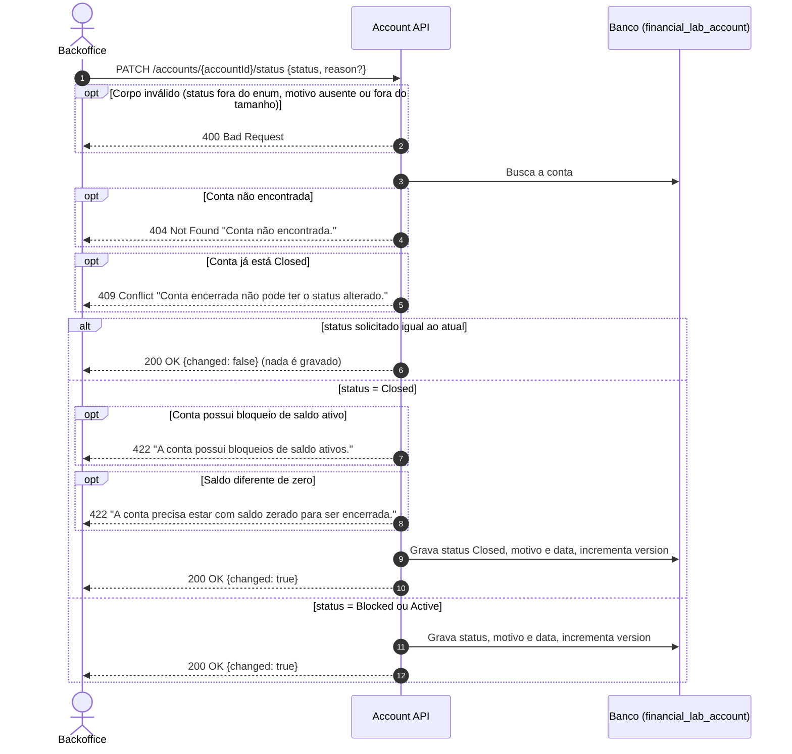

# Alterar Status da Conta

## Versionamento

| Versão | Data | Descrição |
|---|---|---|
| 1.0.0 | 2026-11-13 | Criação da alteração de status e da regra de movimentação de conta bloqueada |

## Contexto

O backoffice precisa bloquear, desbloquear e encerrar contas. Junto com a rota nova, muda a regra de movimentação: conta `Blocked` continua recebendo créditos, mas não pode ser debitada.

- Rota: `PATCH /accounts/{accountId}/status` (Account API, porta `5157`)
- Verificação: `GET /accounts/{accountId}` (status, `statusReason`) e `GET /accounts/{accountId}/balance` (`status`, `version`)
- Não há autenticação.
- Erros seguem `application/problem+json` (`title`, `status`, `detail`).

## Diagrama

## Contrato

### Requisição

| Campo | Tipo | Obrigatório | Regras |
|---|---|---|---|
| `status` | string | sim | `Active`, `Blocked` ou `Closed` (exatamente assim) |
| `reason` | string | para `Blocked` e `Closed` | Espaços nas pontas são removidos. Se informado, entre 5 e 200 caracteres |

### Resposta `200`

| Campo | Tipo | Descrição |
|---|---|---|
| `accountId` | guid | |
| `previousStatus` | string | Status antes da chamada |
| `status` | string | Status depois da chamada |
| `reason` | string \| null | Motivo vigente da conta |
| `changedAt` | datetime (UTC) \| null | Data da última mudança de status da conta |
| `changed` | bool | `false` quando o status pedido já era o atual |

## Regras

| # | Regra | Status | `detail` |
|---|---|---|---|
| R1 | `status` ausente ou fora do enum (inclusive `blocked` minúsculo) | 400 | `Status inválido. Valores aceitos: Active, Blocked, Closed.` |
| R2 | `status` `Blocked` ou `Closed` sem `reason` (ou só espaços) | 400 | `O motivo é obrigatório para bloquear ou encerrar a conta.` |
| R3 | `reason` informado com menos de 5 ou mais de 200 caracteres | 400 | `O motivo deve ter entre 5 e 200 caracteres.` |
| R4 | Conta inexistente | 404 | `Conta não encontrada.` |
| R5 | Conta atual `Closed` (qualquer status pedido, inclusive `Closed`) | 409 | `Conta encerrada não pode ter o status alterado.` |
| R6 | Encerrar conta com bloqueio de saldo ativo | 422 | `A conta possui bloqueios de saldo ativos.` |
| R7 | Encerrar conta com `balance` diferente de zero | 422 | `A conta precisa estar com saldo zerado para ser encerrada.` |

- As regras são avaliadas na ordem da tabela.
- Transições permitidas: `Active → Blocked`, `Blocked → Active`, `Active → Closed`, `Blocked → Closed`. `Closed` é terminal.
- Status pedido igual ao atual (`Active → Active`, `Blocked → Blocked`): responde `200` com `changed: false`, `previousStatus` igual a `status`, e **não** altera `version`, `statusReason` nem a data da mudança, mesmo que o `reason` enviado seja diferente.
- Em toda mudança efetiva, `version` aumenta em 1, `statusReason` passa a ser o `reason` enviado e `changedAt` é a data da mudança.
- Desbloqueio (`Blocked → Active`) sem `reason` limpa o `statusReason` (fica `null`).
- `Balance`, `blockedBalance` e o extrato não mudam com a alteração de status.

### Movimentação por status

| Status | Débito (`DebitAccount`) | Crédito (`CreditAccount`) |
|---|---|---|
| `Active` | permitido | permitido |
| `Blocked` | recusado: `Conta Blocked: débito não permitido.` | permitido |
| `Closed` | recusado: `Conta Closed: movimentação não permitida.` | recusado: `Conta Closed: movimentação não permitida.` |

Efeito observável pela Transfer API (`POST /transfers`, porta `5257`):
- origem `Blocked`: a transferência termina `Failed` com `failureReason` `Conta Blocked: débito não permitido.` e o saldo da origem não muda
- destino `Blocked`: a transferência termina `Completed` e o destino é creditado
- destino `Closed`: a transferência termina `Refunded` e a origem recebe o valor de volta
