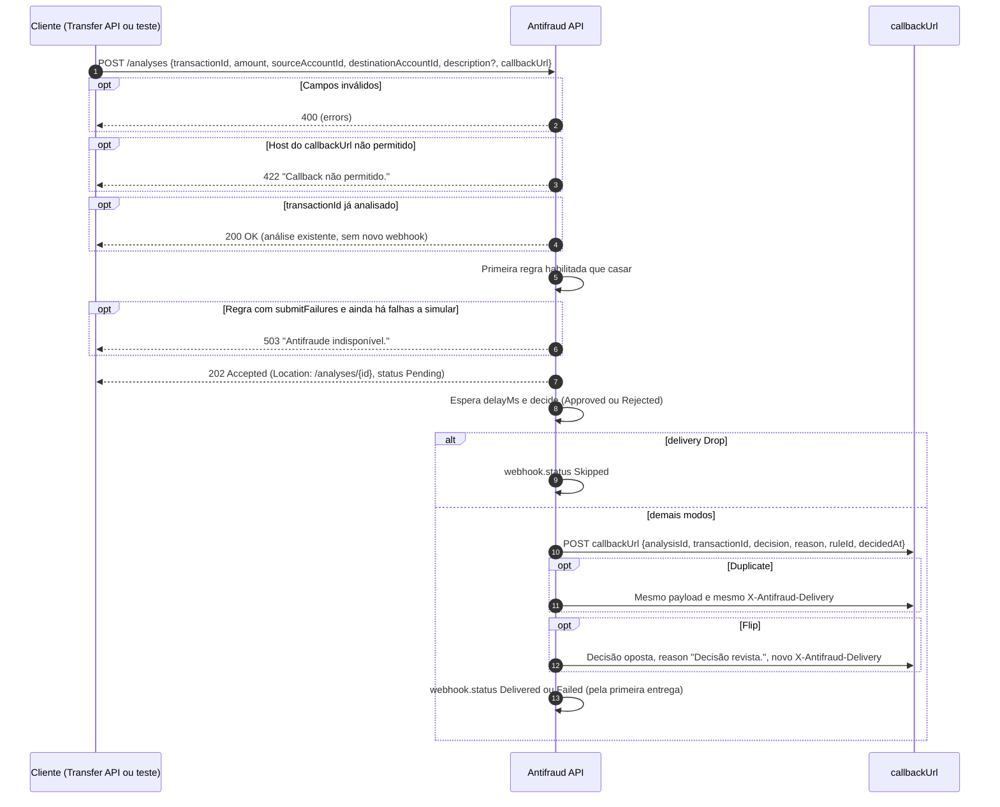

# Análises do Antifraude

## Versionamento

| Versão | Data | Descrição |
|---|---|---|
| 1.0.0 | 2026-11-18 | Submissão de análises, decisão por regras e entrega da decisão por webhook |

## Contexto

O antifraude simulado recebe a transação, decide pelas regras (spec "Regras do Antifraude") depois de um atraso e entrega a decisão no `callbackUrl` por webhook assinado, com retry. O modo de entrega da regra permite simular webhooks repetidos, perdidos, com assinatura errada ou contraditórios.

- Rotas (Antifraud API, porta `5357`):

| Método | Rota | Efeito |
|---|---|---|
| `POST` | `/analyses` | Submete uma transação para análise |
| `GET` | `/analyses/{analysisId}` | Devolve uma análise (`404` sem corpo se não existir) |
| `GET` | `/analyses?transactionId=<id>` | Lista com a análise da transação, ou lista vazia. Comparação exata |
| `GET` | `/analyses?take=<n>` | Últimas análises, da mais nova para a mais antiga. `take` padrão `50`, limitado entre `1` e `500` |
| `DELETE` | `/analyses` | Apaga todas as análises e os contadores de `submitFailures`. Responde `200` `{ "removed": <n> }` |

- Normalmente quem submete é a Transfer API, com `transactionId` igual ao `endToEndId` da transferência e `callbackUrl` `http://transfer-api:8080/webhooks/antifraud`. O teste também pode submeter diretamente.
- Hosts de callback permitidos (`Antifraud:AllowedCallbackHosts`, ambiente `Development`): `localhost` e `transfer-api`.
- Segredo do webhook (docker-compose): `financial-lab-webhook-secret`.
- Entrega: até 5 tentativas por entrega (`Delivery:MaxAttempts`), espera de 200 ms × 2^(tentativa−1) entre elas, timeout de 5 s por tentativa.
- O estado é em memória e é perdido ao reiniciar o serviço.
- Não há autenticação.
- Erros de validação seguem `application/problem+json` com `errors` (campo → mensagens). Demais erros com `title` e `detail`.

## Diagrama

## Contrato

### Requisição `POST /analyses`

| Campo | Tipo | Obrigatório | Regras |
|---|---|---|---|
| `transactionId` | string | sim | 1 a 64 caracteres. Chave de idempotência |
| `amount` | decimal | sim | Maior que zero |
| `sourceAccountId` | guid | sim | Diferente de `00000000-0000-0000-0000-000000000000` |
| `destinationAccountId` | guid | sim | Diferente de `00000000-0000-0000-0000-000000000000` |
| `description` | string \| null | não | Usada por `descriptionContains` |
| `callbackUrl` | string | sim | URL `http` ou `https` absoluta, com host permitido |

### Resposta (análise)

| Campo | Tipo | Descrição |
|---|---|---|
| `id` | guid | |
| `transactionId` | string | |
| `status` | string | `Pending`, `Approved` ou `Rejected` |
| `reason` | string \| null | `null` enquanto `Pending` |
| `ruleId` | string \| null | Regra que decidiu. `null` enquanto `Pending` ou se nenhuma regra casou |
| `amount`, `sourceAccountId`, `destinationAccountId`, `description` | | Como submetidos |
| `createdAt` | datetime (UTC) | |
| `decidedAt` | datetime (UTC) \| null | |
| `webhook.mode` | string | `delivery` da regra que casou (`Normal` se nenhuma) |
| `webhook.status` | string | `Pending`, `Delivered`, `Failed` ou `Skipped` |
| `webhook.attempts` | lista | `{ deliveryId, attempt, decision, statusCode, error, at }` de cada tentativa, de todas as entregas |

### Webhook enviado

- `POST` no `callbackUrl`, `Content-Type: application/json`.
- Corpo: `{ analysisId, transactionId, decision, reason, ruleId, decidedAt }`, com `decision` `Approved` ou `Rejected`.
- Headers: `X-Antifraud-Delivery` (guid da entrega, igual em todas as tentativas dela), `X-Antifraud-Timestamp` (Unix time em segundos, renovado a cada tentativa) e `X-Antifraud-Signature` (`sha256=` + HMAC-SHA256 hex minúsculo de `<timestamp>.<corpo>`).

## Regras

### Submissão

| # | Regra | Status | Chave em `errors` / `title` | Mensagem |
|---|---|---|---|---|
| R1 | `transactionId` ausente ou só espaços | 400 | `transactionId` | `O transactionId é obrigatório.` |
| R2 | `transactionId` com mais de 64 caracteres | 400 | `transactionId` | `O transactionId deve ter no máximo 64 caracteres.` |
| R3 | `amount` ausente, zero ou negativo | 400 | `amount` | `O valor deve ser maior que zero.` |
| R4 | `sourceAccountId` ausente ou vazio | 400 | `sourceAccountId` | `A conta de origem é obrigatória.` |
| R5 | `destinationAccountId` ausente ou vazio | 400 | `destinationAccountId` | `A conta de destino é obrigatória.` |
| R6 | `callbackUrl` ausente, relativo ou com esquema diferente de `http`/`https` | 400 | `callbackUrl` | `O callbackUrl deve ser uma URL http(s) absoluta.` |
| R7 | Host do `callbackUrl` fora de `AllowedCallbackHosts` (sem diferenciar maiúsculas) | 422 | `Callback não permitido.` | `O host de '{callbackUrl}' não está em AllowedCallbackHosts.` |
| R8 | `transactionId` já analisado | 200 | | Devolve a análise existente no estado atual |
| R9 | Regra que casou tem `submitFailures` N e a transação ainda não falhou N vezes | 503 | `Antifraude indisponível.` | `Falha simulada pela regra {ruleId}.` |
| R10 | Demais casos | 202 | | Análise `Pending`, `Location: /analyses/{id}` |

- R1–R6 vêm juntas em `errors`. R7 só é avaliada sem erros de R1–R6.
- R8: o corpo da repetição é ignorado (inclusive `amount` diferente), nada é reavaliado e nenhum webhook novo é enviado.
- R9: as falhas contam por `transactionId`. Depois de N respostas `503`, a submissão seguinte da mesma transação cria a análise. `DELETE /analyses` zera os contadores.

### Decisão

- A regra é escolhida na submissão: a primeira da lista com `enabled` `true` cujas condições informadas casam todas (spec "Regras do Antifraude").
- Nenhuma regra casou: `Approved`, `reason` `null`, `ruleId` `null`, atraso de 300 ms, entrega `Normal`.
- Regra `Rejected`: `reason` da regra; sem `reason`, `Recusada pela regra {id}.`.
- Regra `Approved`: `reason` da regra (pode ser `null`) e `ruleId` preenchido.
- A análise fica `Pending` por `delayMs` (ou 300 ms) e então passa ao status decidido, com `decidedAt`.

### Entrega do webhook

| # | `delivery` | Comportamento | `webhook.status` |
|---|---|---|---|
| E1 | `Normal` | Uma entrega | `Delivered` se uma tentativa teve resposta 2xx; senão `Failed` |
| E2 | `Duplicate` | Entrega normal e, depois que ela termina, o mesmo payload com o mesmo `X-Antifraud-Delivery` | Pela primeira entrega |
| E3 | `Drop` | Nenhuma chamada. A decisão só é obtida por `GET /analyses` | `Skipped`, sem tentativas |
| E4 | `InvalidSignature` | Entrega com `X-Antifraud-Signature` `sha256=` + 64 zeros. A Transfer API responde `401`, que não é repetido | `Failed`, uma tentativa com `statusCode` `401` |
| E5 | `Flip` | Entrega normal e, depois, outra com a decisão oposta, `reason` `Decisão revista.`, mesmo `ruleId` e novo `X-Antifraud-Delivery` | Pela primeira entrega |

- Retry dentro de cada entrega: em erro de rede, timeout, `408`, `409`, `425`, `429` ou `5xx`, até 5 tentativas no total. Qualquer outra resposta não 2xx (ex.: `400`, `401`, `404`) encerra a entrega na hora.
- `webhook.attempts` registra cada tentativa de cada entrega, com o `decision` enviado, o `statusCode` (ou `null` em erro de rede) e o `error` (ou `null`).
- O `status` da análise não muda com `Flip`: continua o decidido pela regra.
- Pela Transfer API: em `Duplicate` e `Flip`, vale a primeira decisão; em `Drop` e `InvalidSignature`, a decisão chega pela reconciliação (spec "Reconciliação do Antifraude").
