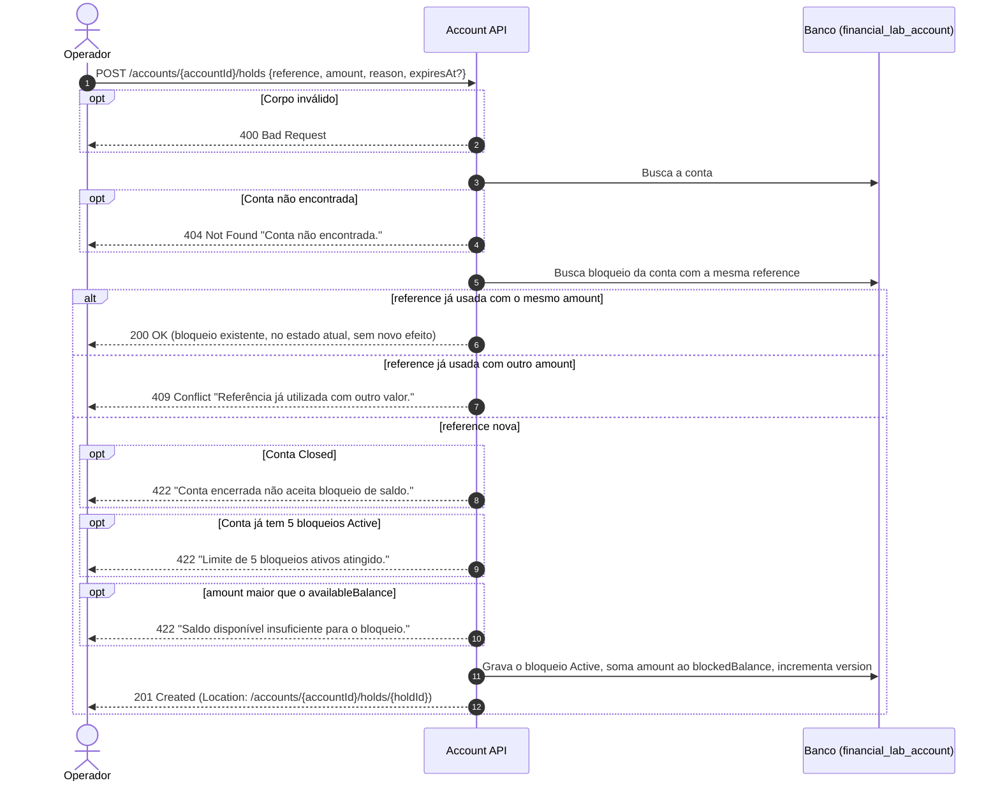

# Criar Bloqueio de Saldo

## Versionamento

| Versão | Data | Descrição |
|---|---|---|
| 1.0.0 | 2026-11-13 | Criação do bloqueio de saldo (reserva de valor) |

## Contexto

Ordens judiciais e garantias exigem reservar parte do saldo de uma conta sem debitá-lo. O valor bloqueado continua no `balance`, mas sai do `availableBalance`, que é o que limita os débitos.

- Rota: `POST /accounts/{accountId}/holds` (Account API, porta `5157`)
- Rotas auxiliares para verificação:
  - `GET /accounts/{accountId}/holds?status=<Active|Released|Expired>` lista os bloqueios da conta, do mais antigo para o mais novo. Sem `status`, lista todos
  - `GET /accounts/{accountId}/holds/{holdId}` devolve um bloqueio (`404` `Bloqueio não encontrado.` se não existir ou for de outra conta)
  - `GET /accounts/{accountId}/balance` mostra `balance`, `blockedBalance`, `availableBalance` e `version`
- A liberação e a expiração estão na spec "Liberar Bloqueio de Saldo".
- Não há autenticação.
- Erros seguem `application/problem+json` (`title`, `status`, `detail`).

## Diagrama

## Contrato

### Requisição

| Campo | Tipo | Obrigatório | Regras |
|---|---|---|---|
| `reference` | string | sim | 1 a 32 caracteres, só letras sem acento, dígitos, `-` e `_`. Única por conta (chave de idempotência) |
| `amount` | decimal | sim | Maior que zero, no máximo 2 casas decimais |
| `reason` | string | sim | Espaços nas pontas são removidos. Entre 5 e 200 caracteres |
| `expiresAt` | datetime (ISO 8601 com fuso) | não | Entre 10 segundos e 90 dias a partir do momento da requisição. Sem ele, o bloqueio não expira |

### Resposta `201` / `200`

| Campo | Tipo | Descrição |
|---|---|---|
| `holdId` | guid | |
| `accountId` | guid | |
| `reference` | string | |
| `amount` | decimal | |
| `reason` | string | |
| `status` | string | `Active`, `Released` ou `Expired` |
| `createdAt` | datetime (UTC) | |
| `expiresAt` | datetime (UTC) \| null | |
| `releasedAt` | datetime (UTC) \| null | Preenchido na liberação ou expiração |

## Regras

| # | Regra | Status | `detail` |
|---|---|---|---|
| R1 | `reference` ausente, vazia, com mais de 32 caracteres ou com caractere fora do permitido | 400 | `A referência deve ter de 1 a 32 caracteres alfanuméricos, hífen ou sublinhado.` |
| R2 | `amount` ausente, zero ou negativo | 400 | `O valor deve ser maior que zero.` |
| R3 | `amount` com mais de 2 casas decimais | 400 | `O valor deve ter no máximo 2 casas decimais.` |
| R4 | `reason` ausente ou fora de 5 a 200 caracteres | 400 | `O motivo deve ter entre 5 e 200 caracteres.` |
| R5 | `expiresAt` a menos de 10 segundos ou a mais de 90 dias do momento da requisição (inclusive no passado) | 400 | `A expiração deve estar entre 10 segundos e 90 dias a partir de agora.` |
| R6 | Conta inexistente | 404 | `Conta não encontrada.` |
| R7 | `reference` já usada nesta conta com `amount` diferente | 409 | `Referência já utilizada com outro valor.` |
| R8 | Conta `Closed` | 422 | `Conta encerrada não aceita bloqueio de saldo.` |
| R9 | Conta já tem 5 bloqueios `Active` | 422 | `Limite de 5 bloqueios ativos atingido.` |
| R10 | `amount` maior que o `availableBalance` | 422 | `Saldo disponível insuficiente para o bloqueio.` |

- As regras são avaliadas na ordem da tabela. A idempotência (R7 e a repetição com mesmo valor) vem antes de R8–R10: repetir uma requisição que já gerou bloqueio responde `200` mesmo que a conta, agora, não tenha mais saldo disponível.
- Repetição com mesma `reference` e mesmo `amount`: responde `200` com o bloqueio original, no estado em que está (pode estar `Released` ou `Expired`). `reason` e `expiresAt` da repetição são ignorados. Nada é gravado e `version` não muda.
- A `reference` é única **por conta**: a mesma `reference` em outra conta cria outro bloqueio.
- Conta `Blocked` aceita bloqueio de saldo.
- `amount` igual ao `availableBalance` é aceito, e o `availableBalance` fica zero.
- Na criação: `blockedBalance` aumenta em `amount`, `availableBalance` diminui em `amount`, `balance` não muda, `version` aumenta em 1, e nenhum lançamento aparece no extrato.
- Com bloqueio ativo, um débito maior que o `availableBalance` é recusado com `Saldo insuficiente.`. Pela Transfer API, a transferência termina `Failed` com esse `failureReason`.
- Bloqueios `Released` e `Expired` não contam para o limite de 5.
