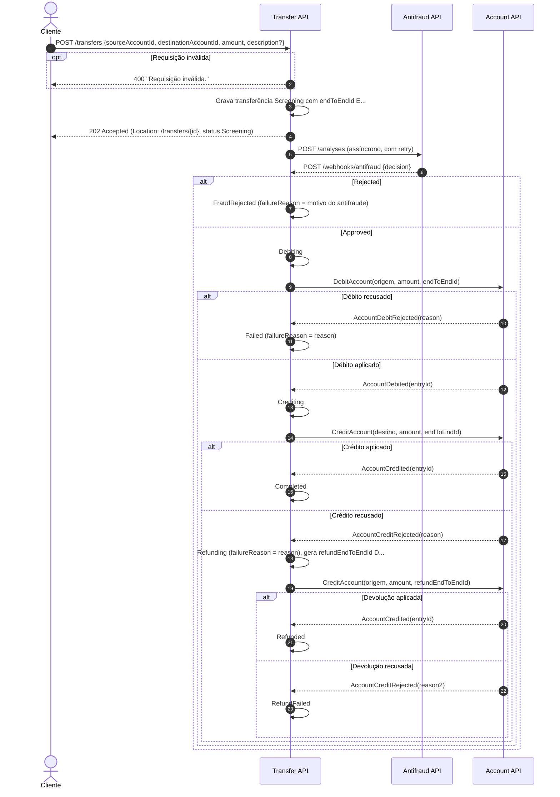

# Criar Transferência

## Versionamento

| Versão | Data | Descrição |
|---|---|---|
| 1.0.0 | 2026-11-18 | Transferência entre contas com análise antifraude, débito, crédito e estorno |
| 1.1.0 | 2026-11-18 | Origem ou destino ausente passa a ser recusado na criação (R5, R6) |

## Contexto

O cliente pede uma transferência entre duas contas. A Transfer API registra o pedido, envia para o antifraude e, se aprovada, pede o débito na origem e o crédito no destino à Account API por mensageria. Se o crédito for recusado, o valor volta para a origem.

- Rota: `POST /transfers` (Transfer API, porta `5257`)
- Rotas auxiliares para verificação:
  - `GET /transfers/{transferId}` devolve a transferência (`404` sem corpo se não existir)
  - `GET /transfers?simulationId=<guid>&status=<status>&take=<n>` lista as transferências, da mais nova para a mais antiga. `take` padrão `50`, limitado entre `1` e `500`. Filtros opcionais
  - `GET /accounts/{accountId}/balance` e `GET /accounts/{accountId}/statement` (Account API, porta `5157`) mostram o efeito nas contas
- O processamento é assíncrono: a resposta é sempre `202` com status `Screening`, e o status final aparece depois via `GET /transfers/{transferId}`. Com o antifraude padrão (atraso de 300 ms), uma transferência aprovada fica `Completed` em cerca de 1 segundo.
- A decisão do antifraude chega por webhook (spec "Webhook do Antifraude") ou por reconciliação (spec "Reconciliação do Antifraude").
- O antifraude é configurável em tempo de execução (spec "Regras do Antifraude"). Com as regras padrão, valores a partir de `1000.00` são recusados com `Valor acima do limite de risco.`.
- Contas de seed (agência `0001`, status `Active`, saldo inicial `30.00`): `11111111-1111-1111-1111-111111111111`, `22222222-2222-2222-2222-222222222222` e `33333333-3333-3333-3333-333333333333`. Os saldos mudam a cada execução; testes devem abrir contas próprias (spec "Abrir Conta") ou ler o saldo antes.
- Não há autenticação.
- Erros seguem `application/problem+json` (`title`, `status`, `detail`).

## Diagrama

## Contrato

### Requisição

| Campo | Tipo | Obrigatório | Regras |
|---|---|---|---|
| `sourceAccountId` | guid | sim | Diferente de `destinationAccountId` |
| `destinationAccountId` | guid | sim | Diferente de `sourceAccountId` |
| `amount` | decimal | sim | Maior que zero, no máximo 2 casas decimais |
| `description` | string | não | No máximo 140 caracteres |

### Resposta `202` / `200` (`GET /transfers/{transferId}`)

| Campo | Tipo | Descrição |
|---|---|---|
| `id` | guid | |
| `sourceAccountId` | guid | |
| `destinationAccountId` | guid | |
| `amount` | decimal | |
| `description` | string \| null | |
| `endToEndId` | string | 32 caracteres: `E` + `99999999` + data/hora UTC `yyyyMMddHHmm` + 11 caracteres alfanuméricos |
| `refundEndToEndId` | string \| null | Mesmo formato, começando com `D`. Preenchido só quando o crédito é recusado |
| `status` | string | Ver tabela de status |
| `failureReason` | string \| null | Motivo da recusa, falha ou estorno |
| `simulationId` | guid \| null | Preenchido só em transferências criadas por simulação |
| `createdAt` | datetime (UTC) | |
| `updatedAt` | datetime (UTC) | Muda a cada troca de status |
| `debit` | perna \| null | Débito na origem, quando aplicado |
| `credit` | perna \| null | Crédito no destino, quando aplicado |
| `refund` | perna \| null | Devolução na origem, quando aplicada |

Perna: `{ accountId, endToEndId, entryId, occurredAt }`. `entryId` é o id do lançamento no extrato da Account API.

### Status

| Status | Final | Significado |
|---|---|---|
| `Screening` | não | Aguardando decisão do antifraude |
| `FraudRejected` | sim | Recusada pelo antifraude ou sem resposta a tempo |
| `Debiting` | não | Aprovada, aguardando débito na origem |
| `Crediting` | não | Debitada, aguardando crédito no destino |
| `Completed` | sim | Debitada na origem e creditada no destino |
| `Failed` | sim | Débito recusado. Nada foi movimentado |
| `Refunding` | não | Crédito recusado, aguardando devolução na origem |
| `Refunded` | sim | Crédito recusado e valor devolvido à origem |
| `RefundFailed` | sim | Crédito recusado e devolução também recusada |

## Regras

### Validação da requisição

| # | Regra | Status | `detail` |
|---|---|---|---|
| R1 | `sourceAccountId` igual a `destinationAccountId` (inclusive ambos ausentes) | 400 | `A conta de origem e a de destino devem ser diferentes.` |
| R2 | `amount` ausente, zero ou negativo | 400 | `O valor deve ser maior que zero.` |
| R3 | `amount` com mais de 2 casas decimais | 400 | `O valor deve ter no máximo 2 casas decimais.` |
| R4 | `description` com mais de 140 caracteres | 400 | `A descrição deve ter no máximo 140 caracteres.` |
| R5 | `sourceAccountId` ausente ou `00000000-0000-0000-0000-000000000000` | 400 | `A conta de origem é obrigatória.` |
| R6 | `destinationAccountId` ausente ou `00000000-0000-0000-0000-000000000000` | 400 | `A conta de destino é obrigatória.` |

- `title` é sempre `Requisição inválida.`. As regras são avaliadas na ordem da tabela, e só a primeira que falhar é devolvida.
- Corpo ausente ou JSON malformado responde `400` sem `detail` fixo.
- Em caso de `400`, nenhuma transferência é gravada.
- A Transfer API não verifica se as contas existem: conta inexistente só aparece como recusa no débito ou no crédito. Id ausente é recusado na criação (R5, R6), porque o antifraude não aceita contas vazias.
- Não há idempotência: duas requisições iguais criam duas transferências.

### Processamento

| # | Situação | Status final | `failureReason` |
|---|---|---|---|
| P1 | Antifraude aprova, débito e crédito aplicados | `Completed` | `null` |
| P2 | Antifraude recusa | `FraudRejected` | Motivo enviado pelo antifraude (ex.: `Valor acima do limite de risco.`). Sem motivo: `Recusada pelo antifraude.` |
| P3 | Antifraude não decide a tempo | `FraudRejected` | `O antifraude não respondeu a tempo.` |
| P4 | Conta de origem inexistente | `Failed` | `Conta {sourceAccountId} não encontrada.` |
| P5 | Conta de origem `Closed` | `Failed` | `Conta Closed: movimentação não permitida.` |
| P6 | Conta de origem `Blocked` | `Failed` | `Conta Blocked: débito não permitido.` |
| P7 | `amount` maior que o `availableBalance` da origem (considera bloqueios de saldo) | `Failed` | `Saldo insuficiente.` |
| P8 | Conta de destino inexistente | `Refunded` | `Conta {destinationAccountId} não encontrada.` |
| P9 | Conta de destino `Closed` | `Refunded` | `Conta Closed: movimentação não permitida.` |
| P10 | Crédito recusado e devolução também recusada (ex.: origem encerrada entre o débito e a devolução) | `RefundFailed` | `<motivo do crédito> Devolução recusada: <motivo da devolução>` |

- A conta de origem é verificada antes da de destino: origem e destino inexistentes resultam em P4.
- Conta de destino `Blocked` recebe crédito normalmente (`Completed`).
- `amount` igual ao `availableBalance` da origem é aceito.
- `failureReason` é truncado em 400 caracteres.

### Efeito nas contas (Account API)

- `Completed`: a origem tem um lançamento `Debit` e o destino um `Credit`, ambos com o `endToEndId` da transferência, o `amount` e a `description` da transferência. `debit.entryId` e `credit.entryId` são os ids desses lançamentos. Cada conta tem `version` aumentada em 1.
- `Refunded`: a origem tem um `Debit` com o `endToEndId` e um `Credit` com o `refundEndToEndId` e `description` `Devolução da transferência {transferId}`. O saldo final da origem é igual ao inicial. O destino não tem lançamento.
- `FraudRejected` e `Failed`: nenhum lançamento em nenhuma conta, e saldos e `version` não mudam.
- Uma transferência nunca gera mais de um débito ou crédito por `endToEndId`, mesmo com mensagens ou webhooks repetidos.
