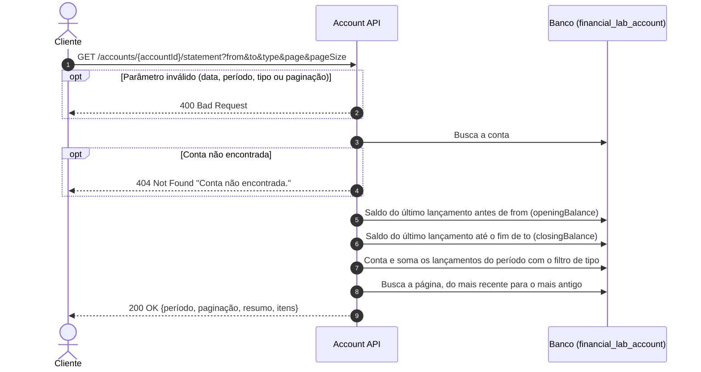

# Extrato da Conta

## Versionamento

| Versão | Data | Descrição |
|---|---|---|
| 1.0.0 | 2026-11-13 | Criação do extrato paginado com resumo do período |

## Contexto

O cliente consulta os lançamentos da conta em um período, com filtro por tipo, paginação e um resumo com saldo inicial, saldo final e totais.

- Rota: `GET /accounts/{accountId}/statement` (Account API, porta `5157`)
- Lançamentos nascem de débitos e créditos (transferências pela Transfer API, depósito inicial da abertura de conta e o saldo de seed das contas de teste, criado em `2026-10-07`).
- Todas as datas são em UTC. Um dia vai de `00:00:00` a `23:59:59.999` UTC.
- Não há autenticação.
- Erros seguem `application/problem+json` (`title`, `status`, `detail`).

## Diagrama

## Contrato

### Parâmetros de consulta

| Parâmetro | Tipo | Padrão | Regras |
|---|---|---|---|
| `from` | data `yyyy-MM-dd` | `to` menos 29 dias | Inclusivo |
| `to` | data `yyyy-MM-dd` | hoje (UTC) | Inclusivo. Não pode ser futuro |
| `type` | string | todos | `Credit` ou `Debit` |
| `page` | int | `1` | Maior ou igual a 1 |
| `pageSize` | int | `20` | Entre 1 e 100 |

### Resposta `200`

| Campo | Tipo | Descrição |
|---|---|---|
| `accountId` | guid | |
| `from` | data | Período efetivo (com padrões aplicados) |
| `to` | data | |
| `type` | string \| null | Filtro aplicado |
| `page` | int | |
| `pageSize` | int | |
| `totalItems` | int | Lançamentos do período que passam no filtro de tipo |
| `totalPages` | int | `ceil(totalItems / pageSize)`. `0` quando não há itens |
| `summary.openingBalance` | decimal | `balanceAfter` do último lançamento anterior a `from`, ou `0` |
| `summary.closingBalance` | decimal | `balanceAfter` do último lançamento até o fim de `to`, ou `openingBalance` se não houver lançamento no período |
| `summary.totalCredits` | decimal | Soma dos créditos do período que passam no filtro de tipo |
| `summary.totalDebits` | decimal | Soma dos débitos do período que passam no filtro de tipo (positivo) |
| `summary.net` | decimal | `totalCredits - totalDebits` |
| `items[]` | lista | Lançamentos da página |
| `items[].entryId` | guid | |
| `items[].type` | string | `Credit` ou `Debit` |
| `items[].amount` | decimal | Sempre positivo |
| `items[].balanceAfter` | decimal | Saldo da conta após o lançamento |
| `items[].endToEndId` | string | |
| `items[].description` | string \| null | |
| `items[].createdAt` | datetime (UTC) | |

## Regras

| # | Regra | Status | `detail` |
|---|---|---|---|
| R1 | `from` ou `to` fora do formato `yyyy-MM-dd` ou data inexistente (`2026-02-30`) | 400 | `Data inválida. Use o formato yyyy-MM-dd.` |
| R2 | `to` depois de hoje (UTC) | 400 | `A data final não pode estar no futuro.` |
| R3 | `from` depois de `to` | 400 | `A data inicial não pode ser posterior à data final.` |
| R4 | Período com mais de 90 dias, contando `from` e `to` | 400 | `O período máximo é de 90 dias.` |
| R5 | `type` diferente de `Credit` ou `Debit` | 400 | `Tipo inválido. Valores aceitos: Credit, Debit.` |
| R6 | `page` menor que 1 | 400 | `A página deve ser maior ou igual a 1.` |
| R7 | `pageSize` fora de 1 a 100 | 400 | `O tamanho da página deve estar entre 1 e 100.` |
| R8 | Conta inexistente | 404 | `Conta não encontrada.` |

- As regras são avaliadas na ordem da tabela.
- Período de exatamente 90 dias (ex.: `from=2026-08-16&to=2026-11-13`) é aceito.
- Sem `from` e sem `to`, o período é de 30 dias terminando hoje. Só com `to`, `from` é `to` menos 29 dias. Só com `from`, `to` é hoje (sujeito à R4).
- Itens ordenados por `createdAt` decrescente. Empate é desfeito pelo `entryId` decrescente.
- Página além da última: `200` com `items` vazio e os totais preenchidos normalmente.
- O filtro `type` afeta `items`, `totalItems`, `totalPages`, `totalCredits`, `totalDebits` e `net`, mas **não** afeta `openingBalance` nem `closingBalance`.
- Sem filtro de tipo, vale `closingBalance = openingBalance + net`.
- Bloqueios de saldo e mudanças de status não aparecem no extrato.
- Conta `Blocked` ou `Closed` continua tendo extrato.
- Débitos e créditos recusados não geram lançamento.
