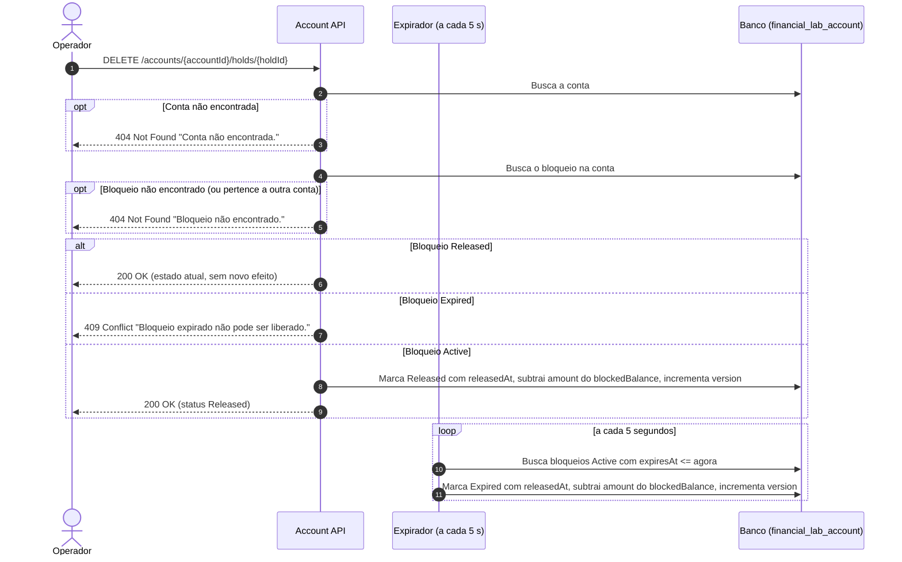

# Liberar Bloqueio de Saldo

## Versionamento

| Versão | Data | Descrição |
|---|---|---|
| 1.0.0 | 2026-11-13 | Criação da liberação manual e da expiração automática de bloqueios |

## Contexto

Um bloqueio de saldo (ver spec "Criar Bloqueio de Saldo") deixa de reter o valor quando é liberado pelo operador ou quando chega o `expiresAt`.

- Rota: `DELETE /accounts/{accountId}/holds/{holdId}` (Account API, porta `5157`)
- Verificação: `GET /accounts/{accountId}/holds/{holdId}`, `GET /accounts/{accountId}/holds?status=...` e `GET /accounts/{accountId}/balance`
- Expiração: um processo interno da Account API roda a cada 5 segundos e expira os bloqueios `Active` cujo `expiresAt` já passou. Um bloqueio vencido pode continuar `Active` por até ~5 segundos.
- Não há autenticação.
- Erros seguem `application/problem+json` (`title`, `status`, `detail`).

## Diagrama

## Contrato

### Resposta `200`

Mesmo corpo do bloqueio na spec "Criar Bloqueio de Saldo": `holdId`, `accountId`, `reference`, `amount`, `reason`, `status`, `createdAt`, `expiresAt`, `releasedAt`.

## Regras

| # | Regra | Status | `detail` |
|---|---|---|---|
| R1 | `accountId` ou `holdId` que não é um guid | 404 | (sem corpo) |
| R2 | Conta inexistente | 404 | `Conta não encontrada.` |
| R3 | Bloqueio inexistente ou de outra conta | 404 | `Bloqueio não encontrado.` |
| R4 | Bloqueio `Expired` | 409 | `Bloqueio expirado não pode ser liberado.` |

- Liberação de bloqueio `Active`: responde `200` com `status` `Released` e `releasedAt` preenchido. `blockedBalance` diminui em `amount`, `availableBalance` aumenta em `amount`, `balance` não muda, `version` aumenta em 1.
- Liberação repetida de bloqueio já `Released`: responde `200` com o mesmo corpo da primeira liberação (mesmo `releasedAt`). Nada é gravado, `version` e saldos não mudam.
- Expiração: o bloqueio passa a `Expired` com `releasedAt` igual ao momento em que foi processado (maior ou igual ao `expiresAt`). Os efeitos no saldo são os mesmos da liberação.
- Bloqueio sem `expiresAt` nunca expira.
- Liberar ou expirar um bloqueio libera vaga no limite de 5 bloqueios ativos e permite encerrar a conta (spec "Alterar Status da Conta").
- Conta `Blocked` pode ter bloqueios liberados.
- Liberação e expiração não geram lançamento no extrato.
