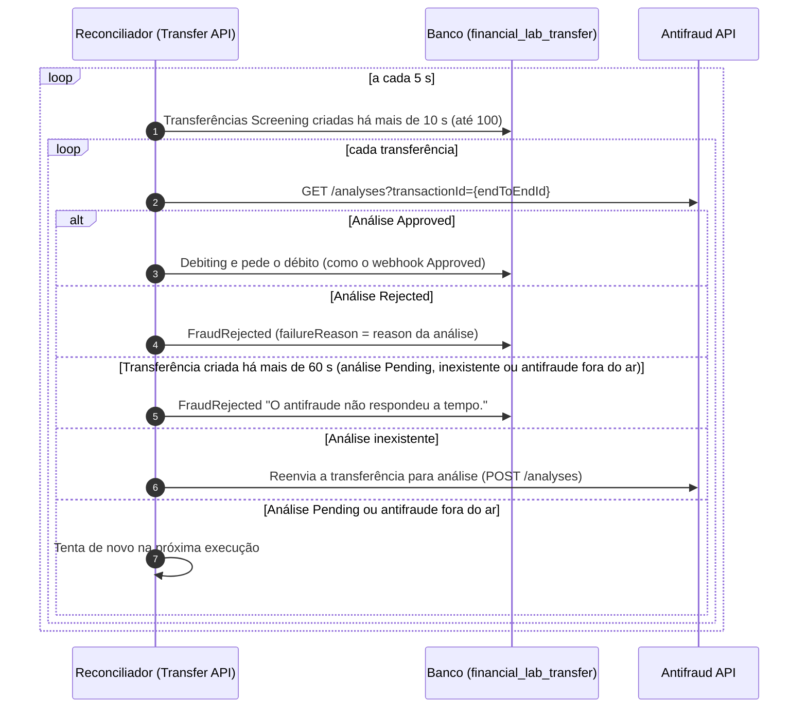

# Reconciliação do Antifraude

## Versionamento

| Versão | Data | Descrição |
|---|---|---|
| 1.0.0 | 2026-11-18 | Consulta ativa ao antifraude e timeout fail-closed de transferências em Screening |

## Contexto

O webhook do antifraude pode não chegar: descartado, recusado por assinatura inválida, ou o envio da análise falhou. Um processo interno da Transfer API procura transferências paradas em `Screening`, consulta o antifraude e, se o tempo limite passar sem decisão, recusa a transferência (fail-closed).

- Não há rota própria. O efeito é observado em `GET /transfers/{transferId}` (Transfer API, porta `5257`).
- O comportamento do antifraude é controlado pelas regras (spec "Regras do Antifraude"): `delivery` (`Drop`, `InvalidSignature`), `delayMs` e `submitFailures`.
- Configuração no docker-compose (ambiente `Development`):

| Parâmetro | Valor | Significado |
|---|---|---|
| `Antifraud:ReconcileIntervalSeconds` | `5` | Intervalo entre execuções |
| `Antifraud:StaleAfterSeconds` | `10` | Idade mínima da transferência para ser reconciliada |
| `Antifraud:TimeoutSeconds` | `60` | Idade a partir da qual, sem decisão, a transferência é recusada |
| `Antifraud:ReconcileBatchSize` | `100` | Máximo de transferências por execução, das mais antigas para as mais novas |

## Diagrama

## Regras

| # | Situação | Resultado | Quando |
|---|---|---|---|
| R1 | Webhook descartado (`delivery` `Drop`) e análise `Approved` | Segue o fluxo normal até `Completed` | Entre ~10 e ~15 s depois da criação |
| R2 | Webhook descartado e análise `Rejected` | `FraudRejected` com o `reason` da análise | Entre ~10 e ~15 s |
| R3 | Webhook com assinatura inválida (`delivery` `InvalidSignature`) | Igual a R1/R2: a Transfer API recusa o webhook com `401` e a reconciliação aplica a decisão | Entre ~10 e ~15 s |
| R4 | Análise ainda `Pending` aos 60 s (`delayMs` maior que ~60000) | `FraudRejected` com `O antifraude não respondeu a tempo.` | Entre ~60 e ~65 s |
| R5 | Antifraude fora do ar (consulta falha) até os 60 s | `FraudRejected` com `O antifraude não respondeu a tempo.` | Entre ~60 e ~65 s |
| R6 | Análise inexistente (envio falhou em todas as tentativas, ou as análises foram apagadas com `DELETE /analyses`) | A transferência é reenviada ao antifraude e segue com a nova análise | A cada execução até existir análise |
| R7 | Análise inexistente aos 60 s | `FraudRejected` com `O antifraude não respondeu a tempo.` | Entre ~60 e ~65 s |

- Transferências com menos de 10 s de idade nunca são reconciliadas: dentro desse intervalo só o webhook decide.
- Uma decisão `Approved` ou `Rejected` encontrada na consulta tem prioridade sobre o timeout: se a análise já decidiu, a decisão vale mesmo depois dos 60 s.
- Depois de reconciliada, a transferência sai de `Screening` e webhooks atrasados são ignorados (spec "Webhook do Antifraude"). Ex.: com `delayMs` `90000`, a transferência fica `FraudRejected` por timeout perto dos 60 s, e o webhook `Approved` aos 90 s responde `200` sem mudar nada.
- Envio da análise com falha (`submitFailures`): cada envio é tentado até 6 vezes em poucos segundos. Com `submitFailures` até 5, a análise é criada já no primeiro envio e não há reconciliação. Com mais, as tentativas seguintes vêm dos reenvios de R6, e a transferência é decidida assim que a análise for criada, desde que antes dos 60 s.
- Os tempos são aproximados: somam o intervalo de 5 s, o atraso da análise e o processamento.
