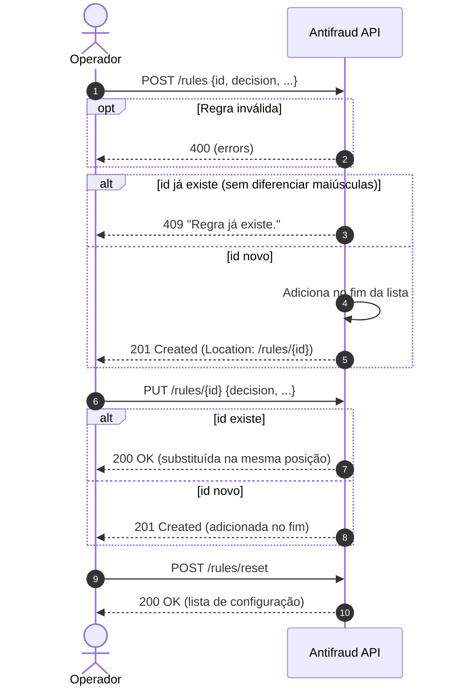

# Regras do Antifraude

## Versionamento

| Versão | Data | Descrição |
|---|---|---|
| 1.0.0 | 2026-11-18 | Configuração das regras do antifraude simulado em tempo de execução |

## Contexto

O antifraude simulado decide cada análise pela primeira regra habilitada que casar com a transferência. As regras também controlam o atraso da decisão e falhas simuladas (envio e webhook), e podem ser trocadas em tempo de execução para montar cenários de teste.

- Rotas (Antifraud API, porta `5357`):

| Método | Rota | Efeito |
|---|---|---|
| `GET` | `/rules` | Lista as regras, na ordem de avaliação |
| `GET` | `/rules/{id}` | Devolve uma regra |
| `POST` | `/rules` | Adiciona uma regra no fim da lista |
| `PUT` | `/rules/{id}` | Cria (no fim) ou substitui (na mesma posição) uma regra |
| `PUT` | `/rules` | Substitui a lista inteira |
| `DELETE` | `/rules/{id}` | Remove uma regra |
| `POST` | `/rules/reset` | Volta às regras de configuração |

- O estado é em memória e global: vale para todas as transferências e é perdido ao reiniciar o serviço (volta às regras de configuração). Testes que mudam regras devem chamar `POST /rules/reset` ao terminar.
- Regras de configuração (padrão):

| `id` | `enabled` | `decision` | Condição | `reason` |
|---|---|---|---|---|
| `valor-alto` | `true` | `Rejected` | `minAmount` `1000.00` | `Valor acima do limite de risco.` |
| `destino-bloqueado` | `false` | `Rejected` | `destinationAccountIds` `[33333333-3333-3333-3333-333333333333]` | `Conta de destino em lista restritiva.` |

- O efeito das regras nas análises está na spec "Análises do Antifraude".
- Não há autenticação.
- Erros de validação seguem `application/problem+json` com `errors` (campo → mensagens). Demais erros com `title` e `detail`.

## Diagrama

## Contrato

### Regra (requisição e resposta)

| Campo | Tipo | Obrigatório | Padrão | Regras |
|---|---|---|---|---|
| `id` | string | sim | | 1 a 64 caracteres. Único na lista, sem diferenciar maiúsculas. Em `PUT /rules/{id}`, o `id` da rota substitui o do corpo |
| `enabled` | bool | não | `true` | Regra desabilitada nunca casa |
| `decision` | string | não | `Rejected` | `Approved` ou `Rejected` |
| `reason` | string \| null | não | `null` | Motivo da decisão |
| `minAmount` | decimal \| null | não | `null` | Maior ou igual a 0. Casa se `amount >= minAmount` |
| `maxAmount` | decimal \| null | não | `null` | Maior ou igual a 0 e a `minAmount`. Casa se `amount <= maxAmount` |
| `sourceAccountIds` | guid[] \| null | não | `null` | Casa se a origem estiver na lista. Lista vazia ou `null` não filtra |
| `destinationAccountIds` | guid[] \| null | não | `null` | Casa se o destino estiver na lista. Lista vazia ou `null` não filtra |
| `descriptionContains` | string \| null | não | `null` | Casa se a descrição contiver o texto, sem diferenciar maiúsculas. Transferência sem descrição não casa |
| `delayMs` | int \| null | não | `null` | Entre 0 e 120000. `null` usa o padrão do serviço (300 ms) |
| `delivery` | string | não | `Normal` | `Normal`, `Duplicate`, `Drop`, `InvalidSignature` ou `Flip` |
| `submitFailures` | int | não | `0` | Entre 0 e 20. Responde `503` às primeiras N submissões de cada transação |

A resposta traz todos os campos, com `null` nos não informados.

### Respostas

| Rota | Sucesso | Corpo |
|---|---|---|
| `GET /rules` | 200 | Lista de regras |
| `GET /rules/{id}` | 200 | Regra |
| `POST /rules` | 201 | Regra criada |
| `PUT /rules/{id}` | 201 (criada) / 200 (substituída) | Regra |
| `PUT /rules` | 200 | Lista resultante |
| `DELETE /rules/{id}` | 204 | — |
| `POST /rules/reset` | 200 | Lista de configuração |

## Regras

| # | Regra | Status | Chave em `errors` / `title` | Mensagem |
|---|---|---|---|---|
| R1 | `id` ausente ou só espaços | 400 | `rule.id` | `O id é obrigatório.` |
| R2 | `id` com mais de 64 caracteres | 400 | `rule.id` | `O id deve ter no máximo 64 caracteres.` |
| R3 | `minAmount` negativo | 400 | `rule.minAmount` | `O valor mínimo não pode ser negativo.` |
| R4 | `maxAmount` negativo | 400 | `rule.maxAmount` | `O valor máximo não pode ser negativo.` |
| R5 | `minAmount` maior que `maxAmount` (ambos informados) | 400 | `rule.minAmount` | `O valor mínimo deve ser menor ou igual ao máximo.` |
| R6 | `delayMs` fora de 0 a 120000 | 400 | `rule.delayMs` | `O atraso deve estar entre 0 e 120000 ms.` |
| R7 | `submitFailures` fora de 0 a 20 | 400 | `rule.submitFailures` | `As falhas de envio devem estar entre 0 e 20.` |
| R8 | `PUT /rules` com dois ids iguais (sem diferenciar maiúsculas) | 400 | `rules` | `Ids de regra repetidos: {id}.` |
| R9 | `POST /rules` com `id` já existente | 409 | `Regra já existe.` | `Já existe uma regra com o id '{id}'.` |
| R10 | `GET /rules/{id}` ou `DELETE /rules/{id}` de id inexistente | 404 | — (sem corpo) | |
| R11 | `decision` ou `delivery` com valor desconhecido, ou JSON malformado | 400 | — | Sem formato fixo |

- Todos os erros de validação (R1–R8) vêm juntos em `errors`, não só o primeiro.
- Em `PUT /rules`, as chaves de `errors` usam o índice: `rules[0].id`, `rules[2].delayMs` etc.
- Em caso de erro, a lista de regras não muda (inclusive em `PUT /rules`, que é tudo ou nada).
- `PUT /rules` com lista vazia é aceito: sem regras, toda análise é aprovada.
- `GET`, `PUT` e `DELETE` por id não diferenciam maiúsculas: `/rules/VALOR-ALTO` acha `valor-alto`.
- `POST /rules/reset` descarta todas as mudanças: regras adicionadas somem, e regras padrão alteradas ou removidas voltam com o conteúdo e a ordem da configuração.
- Regras alteradas só afetam análises criadas depois. Uma análise já submetida mantém a decisão, o atraso e o modo de entrega da regra que casou na submissão.
