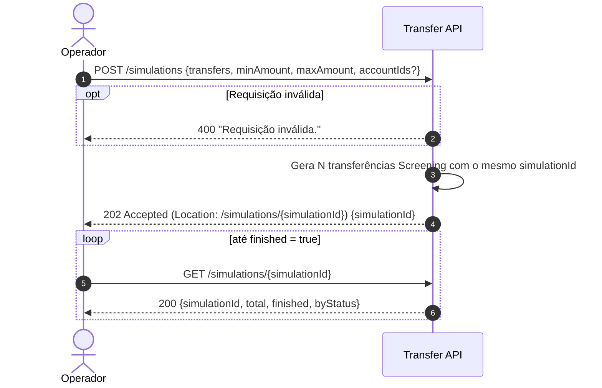

# Simulação de Transferências

## Versionamento

| Versão | Data | Descrição |
|---|---|---|
| 1.0.0 | 2026-11-18 | Geração em lote de transferências aleatórias e resumo por status |

## Contexto

Para gerar carga e observar o comportamento concorrente, o operador pede N transferências aleatórias entre um conjunto de contas. Cada uma segue o fluxo normal da spec "Criar Transferência" e fica marcada com o `simulationId`.

- Rota: `POST /simulations` (Transfer API, porta `5257`)
- Rotas auxiliares para verificação:
  - `GET /simulations/{simulationId}` devolve o resumo por status
  - `GET /transfers?simulationId={simulationId}&status=<status>&take=<n>` lista as transferências da simulação (`take` padrão `50`, máximo `500`)
- Contas padrão (`Lab:AccountIds`, usadas quando `accountIds` não é informado): as 3 contas de seed `11111111-1111-1111-1111-111111111111`, `22222222-2222-2222-2222-222222222222` e `33333333-3333-3333-3333-333333333333`.
- Não há autenticação.
- Erros seguem `application/problem+json` (`title`, `status`, `detail`).

## Diagrama

## Contrato

### Requisição

| Campo | Tipo | Obrigatório | Regras |
|---|---|---|---|
| `transfers` | int | sim | Entre 1 e 1000 |
| `minAmount` | decimal | sim | Maior ou igual a `0.01` |
| `maxAmount` | decimal | sim | Maior ou igual a `minAmount` |
| `accountIds` | guid[] | não | Pelo menos 2 contas distintas. Ausente ou vazio usa as contas padrão |

### Resposta `202`

| Campo | Tipo | Descrição |
|---|---|---|
| `simulationId` | guid | |

### Resposta `200` (`GET /simulations/{simulationId}`)

| Campo | Tipo | Descrição |
|---|---|---|
| `simulationId` | guid | |
| `total` | int | Quantidade de transferências da simulação |
| `finished` | bool | `true` quando nenhuma está em `Screening`, `Debiting`, `Crediting` ou `Refunding` |
| `byStatus` | objeto | Status → quantidade. Só aparecem status com pelo menos uma transferência |

## Regras

| # | Regra | Status | `detail` |
|---|---|---|---|
| R1 | `transfers` ausente, menor que 1 ou maior que 1000 | 400 | `A quantidade de transferências deve estar entre 1 e 1000.` |
| R2 | `minAmount` menor que `0.01`, ou `maxAmount` menor que `minAmount` | 400 | `O intervalo de valores deve ter mínimo >= 0,01 e máximo >= mínimo.` |
| R3 | Menos de 2 contas distintas em `accountIds` (ids repetidos contam uma vez) | 400 | `A simulação precisa de pelo menos duas contas.` |
| R4 | `GET /simulations/{simulationId}` de simulação inexistente | 404 | — (sem corpo) |

- `title` é sempre `Requisição inválida.`. As regras são avaliadas na ordem da tabela, e só a primeira que falhar é devolvida.
- Em caso de `400`, nenhuma transferência é gravada.
- Cada transferência gerada tem:
  - origem e destino sorteados entre as contas, sempre diferentes entre si;
  - `amount` sorteado entre `minAmount` e `maxAmount`, inclusive, com 2 casas decimais;
  - `description` `Simulação {i}/{transfers}` (ex.: `Simulação 3/50`);
  - `simulationId` preenchido.
- `total` é igual a `transfers` desde a primeira consulta, e a soma de `byStatus` é igual a `total`.
- Logo depois do `202`, todas estão em `Screening` e `finished` é `false`.
- As contas não são validadas: contas inexistentes geram transferências `Failed` ou `Refunded`.
- Com `maxAmount` a partir de `1000.00` e as regras padrão do antifraude, parte das transferências termina `FraudRejected`.
- Use `minAmount` e `maxAmount` com no máximo 2 casas decimais; com mais casas o resultado não é definido.
- Com saldo limitado nas contas, transferências concorrentes podem terminar `Failed` com `Saldo insuficiente.`. A soma dos saldos das contas envolvidas não muda ao fim da simulação (dinheiro não é criado nem destruído).
