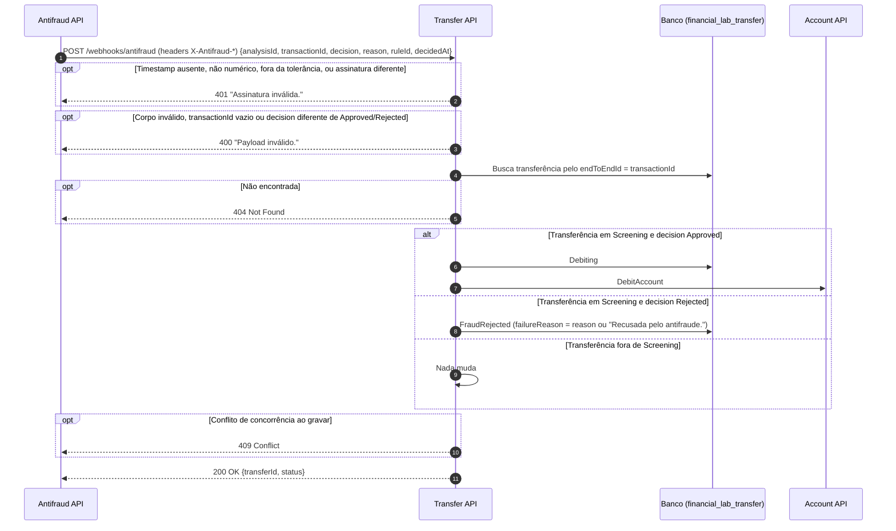

# Webhook do Antifraude

## Versionamento

| Versão | Data | Descrição |
|---|---|---|
| 1.0.0 | 2026-11-18 | Recebimento da decisão do antifraude por webhook assinado |

## Contexto

O antifraude externo devolve a decisão de cada transferência chamando um webhook da Transfer API. A chamada é assinada com HMAC-SHA256 e pode chegar repetida, fora de ordem ou com decisões contraditórias; só a primeira decisão válida muda a transferência.

- Rota: `POST /webhooks/antifraud` (Transfer API, porta `5257`)
- Verificação: `GET /transfers/{transferId}` (Transfer API) e `GET /analyses/{analysisId}` (Antifraud API, porta `5357`, campo `webhook.attempts`)
- Quem chama normalmente é a Antifraud API (spec "Análises do Antifraude"). O teste pode chamar a rota diretamente, assinando com o segredo do laboratório.
- Segredo compartilhado (docker-compose e `Development`): `financial-lab-webhook-secret`.
- Tolerância de relógio: 300 segundos (`Antifraud:SignatureToleranceSeconds`).
- Não há outra autenticação.
- Erros seguem `application/problem+json` (`title`, `status`). `404` e `409` respondem sem corpo.

## Diagrama

## Contrato

### Headers

| Header | Obrigatório | Regras |
|---|---|---|
| `X-Antifraud-Timestamp` | sim | Unix time em segundos. Diferença para o relógio da Transfer API de no máximo 300 segundos, para trás ou para frente |
| `X-Antifraud-Signature` | sim | `sha256=` + HMAC-SHA256 em hexadecimal minúsculo, com chave = segredo e mensagem = `<timestamp>.<corpo>` (corpo bruto, exatamente os bytes enviados, em UTF-8) |
| `X-Antifraud-Delivery` | não | Id da entrega. Só aparece nos logs |

### Corpo

| Campo | Tipo | Obrigatório | Regras |
|---|---|---|---|
| `analysisId` | guid | não | Ignorado |
| `transactionId` | string | sim | `endToEndId` da transferência |
| `decision` | string | sim | `Approved` ou `Rejected` |
| `reason` | string \| null | não | Vira o `failureReason` em caso de recusa |
| `ruleId` | string \| null | não | Ignorado |
| `decidedAt` | datetime | não | Ignorado |

### Resposta `200`

| Campo | Tipo | Descrição |
|---|---|---|
| `transferId` | guid | |
| `status` | string | Status da transferência depois do webhook |

## Regras

| # | Regra | Status | `title` |
|---|---|---|---|
| R1 | `X-Antifraud-Timestamp` ou `X-Antifraud-Signature` ausente | 401 | `Assinatura inválida.` |
| R2 | Timestamp não numérico ou mais de 300 segundos distante do relógio da Transfer API | 401 | `Assinatura inválida.` |
| R3 | Assinatura não confere (segredo errado, corpo alterado depois de assinar, timestamp diferente do assinado, letras maiúsculas no hex, sem prefixo `sha256=`) | 401 | `Assinatura inválida.` |
| R4 | Corpo não é JSON válido, `transactionId` ausente ou vazio, `decision` ausente, `Pending` ou valor desconhecido | 400 | `Payload inválido.` |
| R5 | Nenhuma transferência com `endToEndId` igual a `transactionId` (inclusive um `refundEndToEndId`) | 404 | — |
| R6 | A transferência mudou ao mesmo tempo por outro evento | 409 | — |

- As regras são avaliadas na ordem da tabela: a assinatura é verificada antes de ler o corpo, então um corpo inválido com assinatura inválida responde `401`.
- `401` e `400` não alteram nada.
- Só uma transferência em `Screening` muda:
  - `Approved` → `Debiting` e segue o fluxo da spec "Criar Transferência".
  - `Rejected` → `FraudRejected`, com `failureReason` igual a `reason`; com `reason` ausente, vazio ou só espaços, `Recusada pelo antifraude.`.
- Fora de `Screening`, qualquer webhook válido responde `200` com o status atual e não muda nada. Por isso:
  - Webhook repetido (mesma decisão) não gera segundo débito.
  - Decisão contrária depois da primeira (`Approved` seguido de `Rejected` ou o inverso) é ignorada: vale a primeira que chegou.
  - Decisão que chega depois do timeout de reconciliação (`FraudRejected` com `O antifraude não respondeu a tempo.`) é ignorada.
- Do lado da Antifraud API, `401`, `400` e `404` encerram a entrega sem retry; `409` e `5xx` são repetidos (spec "Análises do Antifraude").
